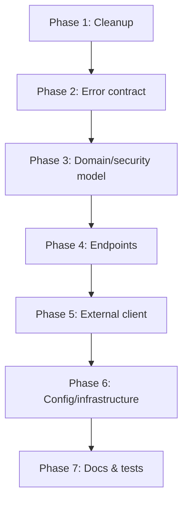

# Book Tracker API — Refactor Plan

Plan for taking the Book Tracker API from its state on the `main` branch to a professional-quality
codebase. Each task is self-contained, ordered so the build stays green between tasks where possible,
and small enough to review in isolation.

## Contents

1. [Overview](#overview)
2. [Starting point](#starting-point)
3. [Guiding principles](#guiding-principles)
4. [Sequencing](#sequencing)
5. [Phase 1 — Cleanup and consistency](#phase-1--cleanup-and-consistency)
6. [Phase 2 — Error contract](#phase-2--error-contract)
7. [Phase 3 — Domain and security model](#phase-3--domain-and-security-model)
8. [Phase 4 — Endpoints and behaviour](#phase-4--endpoints-and-behaviour)
9. [Phase 5 — External integration](#phase-5--external-integration)
10. [Phase 6 — Configuration and infrastructure](#phase-6--configuration-and-infrastructure)
11. [Phase 7 — Documentation and tests](#phase-7--documentation-and-tests)
12. [Verification checklist](#verification-checklist)
13. [Gotchas worth knowing before starting](#gotchas-worth-knowing-before-starting)
14. [Deferred work](#deferred-work)

---

## Overview

The `main` branch is a working Spring Boot 4.1 REST API for tracking a personal reading list.
It layers cleanly (controller → service → repository), uses JWT auth and integrates Open Library,
so the architecture is not broken. The refactor targets three categories of problem:

- **Security.** Endpoints accept `userId` as an input, so any logged-in user can read or modify
  another account's data. This is the only issue that would matter in production; everything else
  is cosmetic by comparison.
- **Correctness.** Two latent bugs: CORS preflight is rejected as 401 (an Angular client would fail
  every request), and all four `BookControllerTest` tests fail on context load. Both were shipping
  broken; only the test failure was visible.
- **Professionalism.** Duplicated error payloads with inconsistent casing, dead imports, commented
  debug code, a hardcoded personal email in an HTTP client, `IllegalArgumentException` used for
  conflicts (400 instead of 409), no API docs, no README, no config profiles.

The plan below fixes all three, and folds in a few improvements over my earlier pass:

- Split `UserDetails` off the JPA entity to stop mixing domain and security concerns.
- Rename `Roles` to `Role` and align its id type with the rest of the model.
- Inject a `Clock` so time-sensitive rules can be tested deterministically.
- Use Testcontainers so tests do not require a local Postgres install.
- Add a `DELETE /me/{userBookId}` endpoint that was missing from the original API.
- Add Actuator with a health endpoint.

## Starting point

- Branch: `main`
- Commit at branch tip (as of this plan): `b5b49f0 fix: removed deadweight exception throws`
- Baseline test result: `Tests run: 13, Failures: 0, Errors: 4, Skipped: 0`. The four errors are
  in `BookControllerTest` and are inherited from the state of `main`; the `@WebMvcTest` slice
  registers `JwtAuthenticationFilter` but excludes its `TokenProvider` dependency.

## Guiding principles

- **Behaviour-preserving unless flagged.** Task descriptions call out contract changes explicitly.
- **Each task is a candidate commit.** Prefer small, reviewable commits with imperative subjects.
- **Verify before moving on.** Every task has an explicit verification step. If verification fails,
  fix the failure inside that task rather than deferring it.
- **Do not touch `.env`.** It is git-ignored and holds real credentials. Only `example.env` and
  `application.yaml` may change.

## Sequencing



Tasks inside a phase can usually be reordered. Phase 3 must land before Phase 4 because the
endpoint rewrite depends on the `UserPrincipal` split.

---

## Phase 1 — Cleanup and consistency

### Task 1.1 — Establish a green baseline for the tasks that can be green

**Why.** Know what was already broken before starting so regressions cannot hide.

**Scope.**
- Run `mvnw test` and record the result: which tests pass, which fail, why.
- Confirm PostgreSQL is reachable at the URL used by `BookApplicationTests`.
- No code changes.

**Verification.** A test report captured somewhere durable (a note, an issue).

### Task 1.2 — Remove dead code and unused imports

**Why.** Small but sets the tone. Commented `System.out.println`, unused imports, and duplicate
imports have zero cost to remove and infinite cost to keep.

**Scope.**
- `TokenProvider`: drop the commented `System.out.println` inside the catch block.
- `BookController`: drop `org.apache.coyote.Response`, `OpenLibraryResponseDTO`, `UserBook`.
- `User`: drop unused `java.util.List` and `jakarta.annotation.Nullable`; delete the four
  `isAccountNon...` methods that only call `UserDetails.super.<same method>()`, plus `getPassword`
  and `getUsername` since Lombok's `@Getter` already generates them.

**Verification.** `mvnw test-compile` succeeds. No behaviour change.

### Task 1.3 — Standardize naming and URL prefixes

**Why.** `AuthController` maps to `/v1/auth` while `BookController` maps to `/api/v1/books`. The
DTO field is `coverImgURL` in one place and `coverImgUrl` in another; the mapper only compiles
because Lombok generates `getCoverImgURL()`.

**Scope.**
- Move `AuthController` to `/api/v1/auth`; update `SecurityConfiguration`'s matcher.
- Rename `coverImgURL` → `coverImgUrl` in `Book`, `UserBookResponseDTO`, and the mapper.
  Leave the SQL column name `cover_img_url` unchanged so no migration is needed.
- Fix the incorrect casing in `BookService`'s cover URL literal (`covers.openLibrary.org` →
  `covers.openlibrary.org`).
- Fix the missing leading `/` on `@GetMapping("user/{userId}/stats")` (this endpoint will be
  removed later, but keep the intermediate state clean).

**Verification.** Grep confirms zero remaining `coverImgURL` and `"/v1/auth"` references.
`mvnw test-compile` succeeds.

---

## Phase 2 — Error contract

### Task 2.1 — Introduce a single `ErrorResponseDTO`

**Why.** Five handlers repeat the same shape via `Map.of(...)`, one of them uses `"Error"`
(capital E) as a key, none includes the request path, and callers must parse different keys for
the same concept. Clients want one shape.

**Scope.**
- Create `dto/ErrorResponseDTO` as a `record(LocalDateTime timestamp, int status, String error,
  String message, String path)`.
- Rewrite `GlobalExceptionHandler` around a shared `build(HttpStatusCode, String, HttpServletRequest)`
  helper. Populate `error` from `HttpStatus.getReasonPhrase()` and `path` from `request.getRequestURI()`.
- Add an `ExceptionHandler(Exception.class)` catch-all. Check for
  `org.springframework.web.ErrorResponse` first and reuse `errorResponse.getStatusCode()` so
  framework failures (unknown route, wrong method, unreadable body) keep their real status. Log
  unexpected exceptions and return a generic 500 message.

**Verification.** Hitting a nonexistent path returns the new shape with `status = 404` rather than
a Whitelabel error page or a masked 500.

### Task 2.2 — Use typed exceptions for business errors

**Why.** Duplicate email or username currently throws `IllegalArgumentException`, which the
handler maps to 400. Semantically it is a conflict — 409.

**Scope.**
- `AuthService.register` throws `DuplicateResourceException` for taken email/username; use
  `existsByEmail`/`existsByUsername` on the repository rather than loading the entity.
- Remove the `try/catch(BadCredentialsException)` from `login`; let it propagate so the handler
  can return 401.
- Add a handler for `BadCredentialsException` that returns a generic "Invalid username or password"
  message so the response does not reveal whether the username exists.
- Add `ExternalServiceException` for upstream failures (used in Phase 5); map it to 502.

**Verification.** A unit test on the service confirming 409 for both duplicate-email and
duplicate-username paths.

---

## Phase 3 — Domain and security model

### Task 3.1 — Split `UserDetails` off the JPA entity

**Why.** The `User` entity implements `UserDetails`, mixing domain and security concerns. Any
change to how Spring Security expects to see a principal drags the JPA entity along, and the
entity carries five override methods that only exist for the interface. An adapter cleans this up.

**Scope.**
- Create `security/UserPrincipal` (record or small class) that wraps a `User` and implements
  `UserDetails`.
- `UserDetailsServiceImpl.loadUserByUsername` returns `new UserPrincipal(user)`.
- `User` entity stops implementing `UserDetails` and loses the security-shaped overrides.
- Controllers that used `@AuthenticationPrincipal User` become `@AuthenticationPrincipal
  UserPrincipal principal`; call `principal.user()` (or a `getId()` convenience method on
  `UserPrincipal`) to reach the domain object.

**Verification.** Existing tests still pass; the entity has no Spring Security imports.

### Task 3.2 — Rename `Roles` to `Role` and unify id types

**Why.** The class holds one role, not many; the plural name is confusing. Its id is `Integer`
while every other id in the model is `Long`.

**Scope.**
- Rename the class `Roles` → `Role` and repackage callers.
- Change `Role.id` from `Integer` to `Long`.
- Rename `RolesRepository` → `RoleRepository`.
- Because the underlying SQL column is already `id` and PostgreSQL treats `Integer` and `Long` the
  same at the JDBC layer (both map to `BIGINT`/`INT` depending on Hibernate's inference), the DB
  column type may change. If your production database already has this table, add a migration or
  keep `Integer` — flag this trade-off in the commit message.

**Verification.** Compile passes; the schema in dev is regenerated cleanly.

### Task 3.3 — Strengthen DTO validation

**Why.** `RegisterRequestDTO` uses `@NotBlank` on every field, so `email: "x"` and
`password: "a"` both pass validation. Register should reject clearly invalid input at the
controller boundary rather than deferring to storage-layer surprises.

**Scope.**
- `RegisterRequestDTO`: add `@Email` on `email`, `@Size(min = 8)` on `password`, `@Size(min = 3,
  max = 40)` on `username`.
- `LoginRequestDTO`: keep as is (login should not disclose password rules).

**Verification.** Test that a request with an invalid email or a 3-character password returns 400
with the standard error shape.

---

## Phase 4 — Endpoints and behaviour

### Task 4.1 — Derive the user from the JWT (security fix)

**Why.** This is the reason for the whole refactor. `/api/v1/books/track?userId=1` lets any
authenticated user pass a different `userId` and access another account. Every user-scoped route
must resolve the caller from the `SecurityContext`, not from client input.

**Scope.**
- Move library routes under `/api/v1/books/me`:
  - `GET /me?status=` — list caller's books.
  - `POST /me` — start tracking; returns 201.
  - `GET /me/stats` — reading statistics.
  - `PATCH /me/{userBookId}/progress` — update page.
  - `PATCH /me/{userBookId}/status` — update reading status.
- Every method reads `@AuthenticationPrincipal UserPrincipal principal` and passes
  `principal.getId()` to the service. No endpoint accepts `userId` from the client.
- Replace the pile of `@RequestParam` values with validated request bodies:
  `TrackBookRequestDTO`, `UpdateProgressRequestDTO`, `UpdateStatusRequestDTO`.
- Add an ownership-scoped repository method:
  ```java
  Optional<UserBook> findByIdAndUserId(Long id, Long userId);
  ```
- The service loads records exclusively through that query. When it returns empty, throw
  `ResourceNotFoundException` (404) — **not** 403 — so the API does not disclose which ids exist.

**Contract change.** All library routes change. Since no client exists yet, this is acceptable.

**Verification.**
- Unit tests prove a call scoped to user A returning empty for a record owned by user B raises 404.
- Controller slice test uses `.with(user(principal))` and asserts the correct id reaches the
  service via `verify(bookService).getUserStats(1L)` (a captor is a good debugging tool if the id
  looks wrong; see the resolver gotcha below).

### Task 4.2 — Add DELETE for untracking a book

**Why.** The original API has no way to remove a book from a user's library. Feature completeness
is part of "professional".

**Scope.**
- `DELETE /api/v1/books/me/{userBookId}` returns 204 on success.
- Service method uses `findByIdAndUserId` for the same 404-vs-403 reason as the update methods.

**Verification.** A service test that deleting another user's record raises 404 and does not call
`userBookRepository.delete(...)`.

### Task 4.3 — Inject `Clock` for date operations

**Why.** `BookService` calls `LocalDate.now()` directly in three places (start reading, complete
reading, page-progress-implies-started). Tests cannot pin those dates without reflection or PowerMock.

**Scope.**
- Inject `java.time.Clock` into `BookService`.
- Register a `Clock.systemDefaultZone()` `@Bean` in a configuration class.
- Replace every `LocalDate.now()` with `LocalDate.now(clock)`.

**Verification.** A service test uses a `Clock.fixed(...)` and asserts that completing a book sets
`finishDate` to the fixed date.

### Task 4.4 — Fix CORS preflight

**Why.** Preflight `OPTIONS` requests carry no credentials. When CORS is only configured via
`WebMvcConfigurer`, Spring Security's filter chain rejects the preflight as 401 before MVC can see
it. Every browser call from a future Angular client fails.

**Scope.**
- Replace `CorsConfig implements WebMvcConfigurer` with a `CorsConfigurationSource` `@Bean`.
- Externalize allowed origins to `app.cors.allowed-origins`.
- In `SecurityConfiguration`, add `.cors(Customizer.withDefaults())` so the security chain picks
  the source up.

**Verification.** A test that performs an OPTIONS request with `Origin: http://localhost:4200` and
`Access-Control-Request-Method: GET` receives 200 with the expected `Access-Control-Allow-*`
headers.

---

## Phase 5 — External integration

### Task 5.1 — Harden the Open Library client

**Why.**
- The client hardcodes a personal email in the `User-Agent`. That address ends up in every
  outbound HTTP request the app makes and in every log Open Library keeps.
- The `RestClient` is built inline in the constructor, with no timeouts, so any slowness upstream
  ties up request threads.
- Failures propagate as raw `RestClientResponseException`, which the global handler renders as an
  unhandled 500.

**Scope.**
- Add a dedicated `client/OpenLibraryClientConfig` that produces a configured `RestClient` bean.
  Externalize base URL, User-Agent, connect timeout and read timeout to `application.yaml`.
  Build the `RestClient` directly with `RestClient.builder()` — do **not** try to inject a
  `RestClient.Builder` bean, none is auto-configured in this project and the injection will fail
  at startup.
- `OpenLibraryClient` receives the pre-built `RestClient` through the constructor and holds only
  request logic.
- Add `.onStatus(HttpStatusCode::isError, ...)` and catch `ResourceAccessException` (timeouts,
  connection failures). Translate both into `ExternalServiceException`, which the handler now maps
  to 502.
- Bound results: request `limit=20`.
- Remove the personal email — use a generic `BookTracker/<version>` User-Agent, configurable via
  `OPENLIBRARY_USER_AGENT`.

**Verification.** A `MockRestServiceServer`-backed test covering: (a) a successful search maps the
response, (b) a 5xx upstream response raises `ExternalServiceException`, (c) a 404 upstream
response also raises `ExternalServiceException`, (d) the request includes `limit=20`.

---

## Phase 6 — Configuration and infrastructure

### Task 6.1 — Profiles and safe defaults

**Why.** The default profile currently has `ddl-auto: update` and `show-sql: true`. In any
non-development context this is wrong: SQL logs in production leak information and destabilize
performance, and `update` can quietly drift the schema. Profiles split the safe default from the
convenient dev configuration.

**Scope.**
- `application.yaml` — safe defaults: `ddl-auto: validate`, `show-sql: false`,
  `open-in-view: false`, `spring.datasource.url` sourced from `${DB_URL:...}` (do not hardcode
  the database name).
- `application-dev.yaml` — `ddl-auto: update`, `show-sql: true`, `logging.level.rcm.book: DEBUG`.
- Move CORS origins and Open Library settings into properties.
- Add `src/test/resources/application.properties` with `spring.jpa.hibernate.ddl-auto=update` so
  tests can bootstrap their schema without disturbing the base profile.
- Update `example.env` to list every variable the app requires (including `JWT_KEY` and
  `JWT_EXPIRATION`, which the original template omitted) with guidance on key length and units.

**Verification.** `mvnw spring-boot:run -Dspring-boot.run.profiles=dev` logs SQL; running without
`-P dev` does not.

### Task 6.2 — Pin the test datasource

**Why.** Tests currently pick up whatever `DB_URL` happens to be exported in the developer's
shell. If that variable points at a nonexistent database (a common accident), the whole suite
fails with a confusing error.

**Scope.**
- `BookApplicationTests` gets a `@TestPropertySource(properties = "spring.datasource.url=${TEST_DB_URL:jdbc:postgresql://localhost:5432/book}")`
  annotation.
- Document `TEST_DB_URL` in the README's env-var table.

**Verification.** Exporting `DB_URL=<something-broken>` no longer breaks the test suite as long
as `TEST_DB_URL` is unset or points at a real database.

### Task 6.3 — Testcontainers for integration tests (polish)

**Why.** The single-line `@TestPropertySource` from 6.2 is a workaround. A cleaner solution is to
have the tests start their own Postgres. That gives reproducible builds on any machine — including
CI — with no local database at all.

**Scope.**
- Add the `org.testcontainers:postgresql` and `org.testcontainers:junit-jupiter` dependencies
  (test scope).
- Replace the `@TestPropertySource` on `BookApplicationTests` with a
  `@ServiceConnection`-annotated `@Container PostgreSQLContainer<?>` in a shared base class.
- Delete the workaround from 6.2 once the containers are working. Keep the `TEST_DB_URL`
  documentation as an escape hatch for developers who prefer a local database.

**Verification.** `mvnw test` passes without any `TEST_DB_URL` or local Postgres.

### Task 6.4 — Actuator health endpoint (polish)

**Why.** Any container orchestrator (Kubernetes, ECS, Cloud Run) wants a liveness probe. Actuator
is the standard answer.

**Scope.**
- Add `spring-boot-starter-actuator`.
- Configure `management.endpoints.web.exposure.include=health,info` and
  `management.endpoint.health.show-details=never`.
- Permit `/actuator/health/**` in `SecurityConfiguration`.

**Verification.** `curl localhost:8080/actuator/health` returns `{"status":"UP"}` without a token.

---

## Phase 7 — Documentation and tests

### Task 7.1 — Expand the test suite

**Why.** The original suite is thin: no auth-flow tests, no security tests, no external-client
tests, and the four `BookControllerTest` tests fail to even start.

**Scope.**
- Fix the pre-existing `BookControllerTest` context load failure. The web slice registers
  `JwtAuthenticationFilter` (a `@Component`), so its `TokenProvider` and `UserDetailsService`
  dependencies must be `@MockitoBean`'d. Import `SecurityConfiguration` so
  `@EnableWebSecurity`'s `AuthenticationPrincipalArgumentResolver` is registered — without it,
  Spring MVC silently binds `@AuthenticationPrincipal` as an empty model attribute.
- Add `BookServiceTest` cases for cross-user access: user B cannot read/update/delete user A's
  records. Assert `save`/`delete` are never called.
- Add `AuthServiceTest` covering: successful register with encoded password and default role;
  default role created when absent; 409 on duplicate email; 409 on duplicate username;
  successful login returning token + expiry; `BadCredentialsException` propagates.
- Add `AuthControllerTest` covering: 201 register, 409 duplicate, 400 validation failures, 200
  login, 401 with generic message.
- Add `OpenLibraryClientTest` using `MockRestServiceServer` (see 5.1 verification).
- Add `OpenApiDocsTest` (see 7.2 verification).

**Verification.** The full suite passes with no ignored tests.

### Task 7.2 — Add OpenAPI and Swagger UI

**Why.** No documentation exists. A future Angular client cannot see the contract without reading
the source. Interactive docs make the contract self-serving.

**Scope.**
- Add `org.springdoc:springdoc-openapi-starter-webmvc-ui:3.1.1` (springdoc v3 is the branch that
  supports Spring Boot 4). Pin the version.
- Create `OpenApiConfig` that returns an `OpenAPI` bean with title, version, description, and a
  `bearerAuth` security scheme (`type: http`, `scheme: bearer`, `bearerFormat: JWT`).
- Permit the docs paths in `SecurityConfiguration`: `/v3/api-docs/**`, `/v3/api-docs.yaml`,
  `/swagger-ui/**`, `/swagger-ui.html`.
- Add a `SPRINGDOC_ENABLED` toggle (default `true`) so the docs can be turned off in production.

**Verification.**
- `GET /v3/api-docs` returns 200 without a token, contains the `bearerAuth` scheme, and documents
  the `/api/v1/auth/login`, `/api/v1/books/me`, `/api/v1/books/me/stats` paths.
- Swagger UI loads at `/swagger-ui.html` and the **Authorize** button accepts a JWT.

### Task 7.3 — Write the README

**Why.** A README is table stakes. Setup, configuration, endpoints, errors, tests.

**Scope.**
- Requirements (Java, Postgres, `mvnw` wrapper).
- Getting started: create DB, copy `example.env`, run with the dev profile.
- Environment variable table with defaults and purpose.
- Profile summary (`default` vs `dev`).
- API documentation URLs.
- Endpoint tables (auth + library) with a `curl` example.
- Error shape and status code table.
- How to run the tests, and how `TEST_DB_URL` overrides the default.
- Project layout tree.
- Callout that real environment variables override `.env` — this is the most common cause of "the
  app is connecting to the wrong database".

**Verification.** A newcomer can clone, configure `.env` from `example.env`, run the app, open
Swagger UI, and exercise the API using only the README.

---

## Verification checklist

Before declaring the refactor done, confirm:

- [ ] `mvnw clean test` is green.
- [ ] `git status` is clean.
- [ ] `grep -R "coverImgURL\|/v1/auth\|userId=\|System\.out\.print\|rafaelcardosomachado" src/` is empty.
- [ ] Endpoints require `Authorization: Bearer <token>` (returns 401 without one).
- [ ] A record belonging to another user returns 404, not 403.
- [ ] `POST /api/v1/auth/register` with a duplicate email returns 409 with the standard error shape.
- [ ] `POST /api/v1/auth/login` with wrong credentials returns 401 and a generic message.
- [ ] CORS preflight from `http://localhost:4200` returns 200.
- [ ] `GET /v3/api-docs` and `/swagger-ui.html` are reachable without a token.
- [ ] `GET /actuator/health` returns 200.
- [ ] Running with the default profile logs no SQL; running with `-P dev` does.
- [ ] `example.env` lists every required variable.

## Gotchas worth knowing before starting

These bit me when I did the refactor the first time. Documenting them here saves time.

- **Spring Boot 4 relocated `AutoConfigureMockMvc`.** It lives at
  `org.springframework.boot.webmvc.test.autoconfigure.AutoConfigureMockMvc` in Boot 4, not
  `org.springframework.boot.test.autoconfigure.web.servlet` (Boot 3). Same for `WebMvcTest`.

- **`@WebMvcTest` silently mis-binds `@AuthenticationPrincipal`.** If you disable filters with
  `@AutoConfigureMockMvc(addFilters = false)` or forget to import `SecurityConfiguration`,
  `@EnableWebSecurity`'s `AuthenticationPrincipalArgumentResolver` is not registered. Spring MVC
  then falls back to binding the parameter as a model attribute — you get an empty object with
  `id = null` and no error, only mysteriously failing stubs. Fix: `@Import(SecurityConfiguration.class)`
  and mock `TokenProvider` and `UserDetailsService` as `@MockitoBean`.

- **`JwtAuthenticationFilter` is in the web slice.** Because it is a `@Component`,
  `@WebMvcTest` registers it. Its `TokenProvider` dependency is not in the slice, so the context
  fails to load unless both are mocked. This is the pre-existing failure on `main`.

- **CORS preflight vs Spring Security.** Preflight `OPTIONS` requests have no credentials.
  Configuring CORS only via `WebMvcConfigurer` means the security filter chain rejects preflight
  before MVC can see it. Use a `CorsConfigurationSource` bean and enable `.cors(...)` in the
  filter chain.

- **`spring.datasource.url` from OS environment overrides `.env`.** Spring resolves properties in
  a documented order and OS environment variables outrank the `.env` file. If your shell exports
  `DB_URL`, that is what the app uses regardless of `.env`. Symptoms: "why is the app hitting a
  database I didn't configure?"

- **No `RestClient.Builder` bean is auto-configured** in a project that uses only
  `spring-boot-starter-webmvc` from Boot 4.1. Injecting `RestClient.Builder` fails at startup with
  `NoSuchBeanDefinitionException`. Build the client with `RestClient.builder()` directly.

- **springdoc-openapi versions.** The 2.x line supports Spring Boot 3; the 3.x line supports
  Spring Boot 4. Do not pin from a StackOverflow answer without checking.

## Deferred work

Consciously left out to keep the plan bounded. Worth revisiting when the API has real users.

- **Flyway or Liquibase migrations.** The app relies on Hibernate DDL. Fine for dev, wrong for
  production. Introducing migrations is a small task per se, but requires an initial baseline of
  the current schema and a decision about how to run migrations on startup.
- **Refresh tokens and token revocation.** Current JWTs cannot be invalidated before expiry.
- **Rate limiting on the login endpoint.** Brute-force protection.
- **Pagination on `GET /me`.** The list is unbounded; a heavy user could return thousands of rows.
- **Structured JSON logging.** Trivial to add via a logback configuration; deferred until an
  observability stack is chosen.
- **Admin functionality.** `UserType.ROLE_ADMIN` exists in the enum but is not used anywhere.
  Either remove it or build the admin surface.
